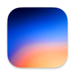
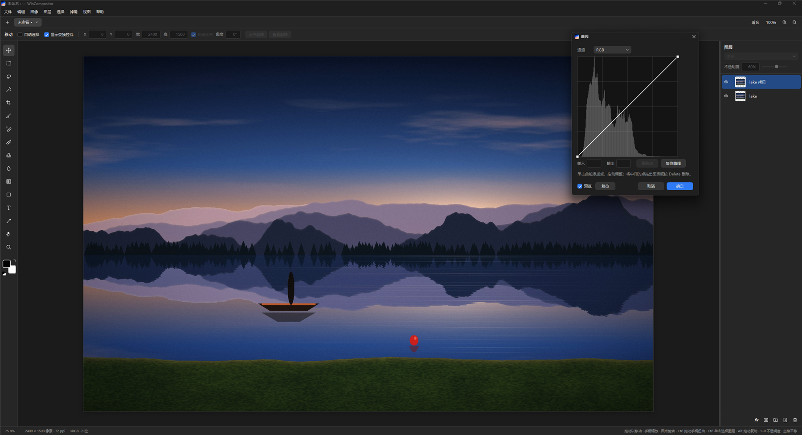
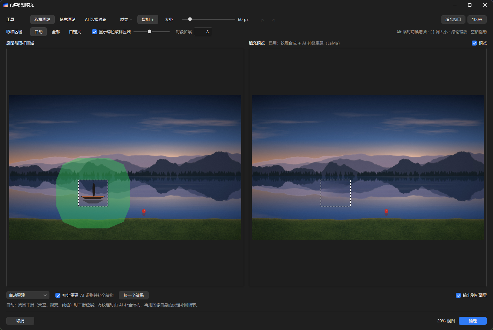
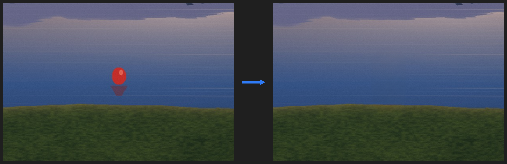
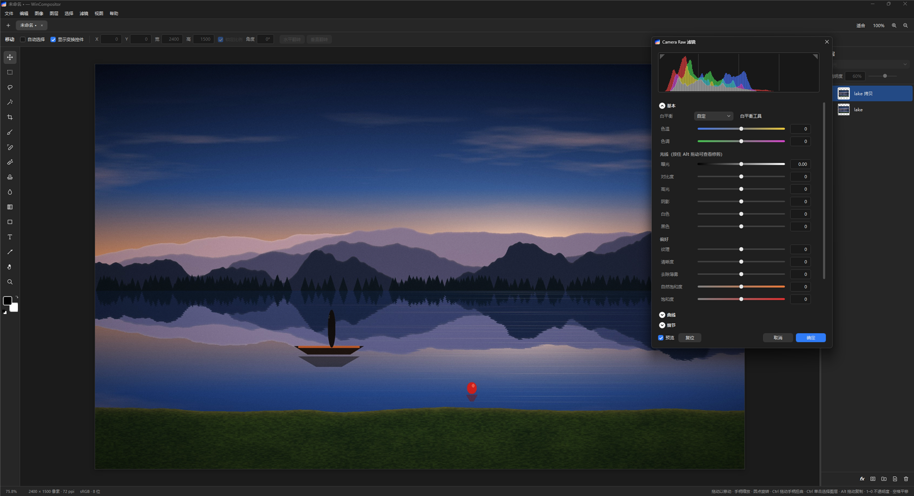
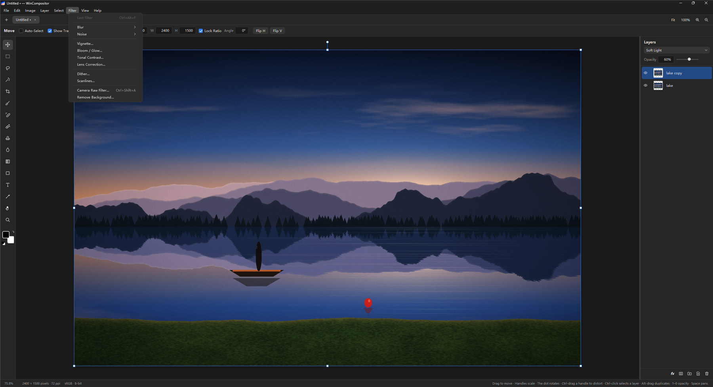
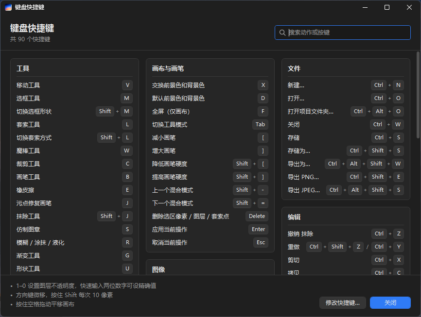
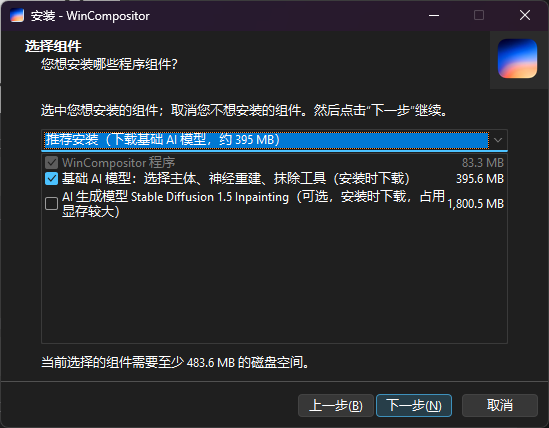

<div align="center">

**简体中文** | [English](README.en.md)



# WinCompositor

**Compositor 的 Windows 版 —— 面向合成与后期处理的类 Photoshop 图像编辑器**

[](https://github.com/biubiu223/WinCompositor/releases)
[](LICENSE)
[](#系统要求)
[](https://dotnet.microsoft.com/download/dotnet/8.0)

<a href="https://github.com/biubiu223/WinCompositor/releases"></a>

当前版本 [**0.1.0-beta.1**](https://github.com/biubiu223/WinCompositor/releases/tag/v0.1.0-beta.1)（测试版）· 简体中文 / English · 免费开源

[亮点](#亮点) · [截图](#截图) · [下载与安装](#下载与安装) · [功能详情](#功能详情) · [从源码构建](#从源码构建) · [许可证与致谢](#许可证与致谢)

</div>

<br>



**WinCompositor** = **Win**dows 版 **Compositor**。[Compositor](https://github.com/robbietilton/Compositor) 是 Robbie Tilton 为 macOS 写的类 Photoshop 图像编辑器，面向合成与后期处理；WinCompositor 按原版源码把它逐个功能重写到了 Windows 上。图层、蒙版、调整图层、Camera Raw、内容识别填充……用法和 Photoshop 一样；AI 功能（选择主体、移除背景、神经重建、AI 生成）用开源模型在本机离线运行。

> [!NOTE]
> 目前是测试版（预发布）。遇到问题欢迎在 [Issues](https://github.com/biubiu223/WinCompositor/issues) 里反馈。

## 亮点

<table>
  <tr>
    <td width="50%" valign="top">
      🎨 <b>Photoshop 式的图层</b><br>
      图层与组、图层蒙版、剪贴蒙版、24 种混合模式、调整图层、图层样式；菜单、术语和快捷键都沿用 Photoshop 的习惯
    </td>
    <td width="50%" valign="top">
      🎞️ <b>Camera Raw 滤镜</b><br>
      基本、曲线、细节、混色器、颜色分级、光学、几何、效果、校准；光线和颜色滑块使用从 Photoshop Camera Raw 实测得到的颜色表
    </td>
  </tr>
  <tr>
    <td width="50%" valign="top">
      🪄 <b>内容识别填充 / 创造式生成</b><br>
      类似 Photoshop 的独立工作区：PatchMatch 纹理合成、LaMa 神经重建，以及 Stable Diffusion 1.5 Inpainting AI 生成（不需要提示词）
    </td>
    <td width="50%" valign="top">
      🧽 <b>抹除工具</b><br>
      在画布上涂抹或圈住要去掉的东西，松开鼠标即自动抹除；AI 会找出整个对象的轮廓，不必涂得很仔细
    </td>
  </tr>
  <tr>
    <td width="50%" valign="top">
      ✂️ <b>AI 选择主体 / 移除背景</b><br>
      一键选中画面主体，单击选中任意对象；移除背景用图层蒙版隐藏背景、不删像素，“高级”品质可以找回发丝
    </td>
    <td width="50%" valign="top">
      📂 <b>打开 PSD / PSB，与 Mac 版互通</b><br>
      导入 PSD 的图层、蒙版、可编辑文字和图层样式；<code>.comp</code> 工程与 Mac 版 Compositor 可以互相打开
    </td>
  </tr>
  <tr>
    <td width="50%" valign="top">
      🌐 <b>中英双语</b><br>
      简体中文和英文界面，术语分别与 Photoshop 中文版、英文版一致；在首选项里切换，重启后生效
    </td>
    <td width="50%" valign="top">
      📦 <b>开箱即用</b><br>
      自带 .NET 运行时，不用另装任何环境；约 78 MB 的在线安装包按需下载 AI 模型，模型在本机离线运行
    </td>
  </tr>
</table>

## 截图

<table>
  <tr>
    <td width="50%" valign="top" align="center">
      <br>
      <b>内容识别填充</b><br>
      <sub>左边是原图，绿色为取样区域；右边是实时填充预览</sub>
    </td>
    <td width="50%" valign="top" align="center">
      <br>
      <b>抹除工具</b><br>
      <sub>左：涂抹前　右：松开鼠标后——浮标和它的倒影一起被抹掉</sub>
    </td>
  </tr>
  <tr>
    <td width="50%" valign="top" align="center">
      <br>
      <b>Camera Raw 滤镜</b><br>
      <sub>滤镜 › Camera Raw 滤镜（Ctrl+Shift+A）</sub>
    </td>
    <td width="50%" valign="top" align="center">
      <br>
      <b>中英双语</b><br>
      <sub>英文界面，在 编辑 › 首选项… 中切换</sub>
    </td>
  </tr>
  <tr>
    <td width="50%" valign="top" align="center">
      <br>
      <b>键盘快捷键速查</b><br>
      <sub>帮助 › 键盘快捷键：工具、画布与菜单命令的当前快捷键</sub>
    </td>
    <td width="50%" valign="top" align="center">
      <br>
      <b>安装向导</b><br>
      <sub>安装时选择要下载哪些 AI 模型</sub>
    </td>
  </tr>
</table>

## 下载与安装

### 系统要求

- Windows 10 1809 或更高版本、Windows 11（64 位）
- **不需要另装运行环境**：.NET 8 运行时（含 WPF）已打包进 `WinCompositor.exe`（约 83 MB），也不需要 VC++ 运行库
- 磁盘空间：程序约 83 MB，加上 AI 模型约 395 MB（推荐安装）或约 2.2 GB（完整安装）
- 选择主体、移除背景等 AI 选择功能有显卡时用显卡运行；AI 生成（Stable Diffusion）在显卡上运行，显存占用较大

### 安装

1. 在 [Releases](https://github.com/biubiu223/WinCompositor/releases) 下载 `WinCompositor-Setup-<版本>.exe`（约 78 MB）。
2. 运行安装包。安装向导按 Windows 显示语言自动选择中文或英文；可以只为当前用户安装（不需要管理员权限），也可以为所有用户安装。
3. 选择安装类型——安装包里只有程序本身，AI 模型在安装时从各自的发布地址（GitHub、Hugging Face）下载，每个文件都用 SHA-256 校验：

| 安装类型 | 下载内容 | 可用的 AI 功能 |
|---|---|---|
| **推荐安装**（默认） | 基础 AI 模型，约 395 MB | 选择主体、对象选择、移除背景、神经重建、抹除工具 |
| **完整安装** | 另加 AI 生成模型约 1.8 GB，共约 2.2 GB | 以上全部，外加 AI 生成（Stable Diffusion 1.5 Inpainting） |
| **仅程序** | 不下载模型 | AI 功能不可用；以后再运行安装包选上模型即可补装 |

也可以选“自定义安装”自己勾选组件。另外：

- 已经装过的模型不会重复下载；某个模型下载失败时可以**重试**，或**忽略**后继续安装其余部分，之后再运行一次安装包补上缺的模型。
- 创建开始菜单快捷方式（桌面快捷方式可选），带卸载程序，卸载时下载的模型一并删除。
- 第一次安装时，程序的界面语言与安装向导一致；以后可在 编辑 › 首选项…（Ctrl+K）里切换。
- 升级：直接运行新版本的安装包即可原地升级。
- 第一次启动要把几个原生组件解包到临时文件夹，需要几秒钟；之后启动约 1 秒。

> [!IMPORTANT]
> **安装 AI 模型需要能访问 GitHub 和 Hugging Face。** 选择主体的模型来自 GitHub，其余模型来自 Hugging Face（huggingface.co）。网络不通时可以先“忽略”，把程序和能下载的部分装好，网络可用后再运行一次安装包补装。

> [!WARNING]
> **SmartScreen 提示**：安装包没有代码签名，Windows 可能显示“Windows 已保护你的电脑”。点 **更多信息** → **仍要运行** 即可继续。浏览器也可能提示这个文件不常被下载，选择保留即可。发布说明里附有安装包的 SHA-256，可以用 PowerShell 的 `Get-FileHash` 核对。

## 功能详情

点开各组查看完整功能。Mac 的 ⌘ 对应 Windows 的 **Ctrl**，⌥ 对应 **Alt**。

<details>
<summary><b>画布与视图</b></summary>

- 多个项目以标签页打开；欢迎页可新建画布（预设、尺寸、分辨率、白 / 黑 / 透明背景）和打开最近的项目
- 把图像或 `.comp` 拖进窗口即可导入 / 打开；也可以从命令行传入路径
- 缩放（Ctrl+滚轮、Ctrl+= / Ctrl+-、缩放工具、按屏幕大小缩放、100%），平移（空格拖动、中键、滚轮、抓手工具）
- 200% 以上像素硬边显示，800% 以上显示像素网格
- 导航器：放大到 300% 以上时画布右上角显示缩略图，可点击 / 拖动移动视图；可在“视图”菜单里关闭
- 标尺、从标尺拖出参考线、网格、对齐（画布、图层、参考线、网格）
- 全屏只显示画布（F）

</details>

<details>
<summary><b>文件：.comp、PSD / PSB、SVG、相机 RAW 与导出</b></summary>

- 读写 `.comp` 工程（格式版本 11，完整校验，原子保存，附带 QuickLook 预览），与 Mac 版互通
- 工程文件被其他程序（同步盘、AI 代理、git 等）修改后自动重新载入；有未存储的更改时先询问
- 打开 / 导入 PNG、JPEG、WebP、GIF、BMP；TIFF、HEIC 等交给 Windows 自带的解码器；按 EXIF 方向自动摆正
- **打开 PSD / PSB**：图层、文件夹、图层蒙版、混合模式、不透明度与填充、剪贴蒙版、色阶 / 曲线 / 色相饱和度调整图层、矩形和椭圆形状图层；打开前列出需要转换的内容
  - 文字图层导入后仍是可编辑文字（字体、字号、颜色、字距、行距、对齐、段落文本框、旋转）；PostScript 字体名（如 ArialMT、MicrosoftYaHei）会对应到已安装的字体
  - 图层样式导入为图层效果：投影、内阴影、外发光、内发光、颜色叠加、描边（含全局光角度、缩放、隐藏状态）；斜面和浮雕、渐变 / 图案叠加等无法对应的会列在导入报告里
- 导入 SVG（渐变、CSS 样式、use、裁剪路径、中文文字等），按画布大小栅格化
- 相机 RAW（DNG 等，借助 Windows 自带的 RAW 解码器；其他品牌需安装 Microsoft Store 的“Raw 图像扩展”）：先显示冲印面板（曝光、色温、色调、增强），以 16 位精度冲印后导入
- 导出 PNG（保留透明）和 JPEG（可调品质），都写入文档分辨率
- 导出为（Ctrl+Alt+Shift+W）：PNG / JPEG / 单页 PDF，可缩放、设背景色，导出前预览并显示文件大小

</details>

<details>
<summary><b>图层、蒙版与图层样式</b></summary>

- 图层与文件夹（编组 / 取消编组 / 拖入拖出 / 嵌套）；文件夹为“穿透”，其不透明度和蒙版作用于内部所有图层
- 不透明度、24 种 Photoshop 混合模式（其中 Skia 没有的 8 种和柔光用 SkSL 按 Photoshop 公式实现）
- 图层蒙版：添加（显示全部 / 隐藏全部 / 显示选区 / 隐藏选区）、在蒙版上绘画、停用、应用、删除、链接 / 取消链接、Alt 单击单独查看蒙版
- 剪贴蒙版（Ctrl+Alt+G 或 Alt 单击图层）
- 新建、复制、删除、重命名（双击）、显示 / 隐藏（可拖过多个眼睛一次切换）、拖动排序、前移 / 后移、向下合并 / 合并图层 / 合并组、右键菜单
- 图层样式：描边、投影、颜色叠加、内阴影、外发光、内发光；图层面板的 fx 子行可单独开关；拷贝 / 粘贴 / 清除图层样式

</details>

<details>
<summary><b>移动、变换与选区</b></summary>

- 移动工具：拖动、手柄缩放（锁定比例 / Shift 切换 / Alt 从中心）、旋转（Shift 15° 步进）、翻转、多图层或整个文件夹一起变换
- Ctrl+T 自由变换（回车应用、Esc 取消），选项栏可精确输入 X、Y、宽、高、角度
- 自由扭曲：变换时按住 Ctrl 拖动手柄，或 编辑 › 扭曲；支持选区内像素、多图层、单独蒙版
- 有选区时拖动 = 移动选区内的像素（Alt 复制）；自动选择图层（或按住 Ctrl 单击）、方向键微移
- 矩形 / 椭圆选框、自由 / 多边形套索、魔棒（容差、取样大小、连续、对所有图层取样）
- 新选区 / 添加（Shift）/ 减去（Alt）；拖动选区内部移动选区；蚂蚁线
- 全选、取消选择、反选、扩展、收缩、羽化、载入图层像素、蒙版的黑色区域
- 色彩范围（选择 › 色彩范围）：吸管取样 / 添加 / 减去、颜色容差、反相，实时预览

</details>

<details>
<summary><b>绘画、修饰与文字</b></summary>

- 画笔 / 橡皮擦：大小、硬度、不透明度、平滑；[ ] 调大小、Shift+[ ] 调硬度、数字键调不透明度、Shift 单击画直线、Alt 吸色、Alt+右键拖动调整笔尖
- 绘画受选区约束，超出图层边界时图层自动扩展
- 填充前景色 / 背景色（Alt / Ctrl+Backspace）、清除、反相
- 吸管、拾色器（HSB 方块 + 色相条 + RGB / HSB / 十六进制）
- 渐变工具（线性 / 径向 / 角度 / 对称 / 菱形，拖动手柄调整后应用）、形状工具（矩形 / 椭圆 / 直线，保持可编辑）
- 文字工具：点文字与段落文字、中文输入法、字体 / 字号 / 颜色 / 对齐 / 行距 / 字距，每个字符可单独设颜色
- 污点修复画笔（内容识别 / 创建纹理）、仿制图章（Alt 单击取样，对齐）、模糊 / 涂抹 / 液化
- 拷贝、剪切、合并拷贝、粘贴（与 Windows 剪贴板互通，带透明度的 PNG）、通过拷贝 / 剪切的图层（Ctrl+J / Ctrl+Shift+J）
- 画布大小（锚点、相对、扩展颜色）、图像大小（重新采样）、裁剪（比例、Alt 对称）、旋转 / 翻转画布
- 图像 › 裁切：按透明像素或左上角 / 右下角像素颜色裁掉边缘

</details>

<details>
<summary><b>调整与滤镜</b></summary>

- 图像 › 调整：色阶（直方图、自动、吸管）、曲线、曝光度、色相/饱和度（分色范围、吸管加减）、色彩平衡、黑白、反相、渐变映射、颗粒
- 图层 › 新建调整图层：上述全部 + 高斯模糊、动感模糊、添加杂色；双击调整图层重新编辑，实时预览，支持蒙版、不透明度、剪贴
- 滤镜：上次滤镜（Ctrl+Alt+F）、高斯模糊、动感模糊、添加杂色
- 暗角（空图层上可直接生成暗角）、泛光、色调对比、镜头校正、仿色（Atkinson、Floyd–Steinberg、Bayer、半调网点 / 线条 / 菱形、Mac 图案、ASCII 字符）、扫描线

</details>

<details>
<summary><b>Camera Raw 滤镜</b></summary>

滤镜 › Camera Raw 滤镜（Ctrl+Shift+A）。光线和颜色滑块使用原版附带的、从 Photoshop Camera Raw 实测得到的颜色表。

- **基本**：白平衡（含吸管和自动）、曝光、对比度、高光、阴影、白色、黑色、纹理、清晰度、去除薄雾、自然饱和度、饱和度
- **曲线**（参数曲线 + 点曲线）、**细节**（锐化、减少杂色）、**混色器**、**颜色分级**
- **光学**（色差、去边、镜头晕影、扭曲）、**几何**、**效果**（颗粒、裁剪后晕影、光晕）、**校准**
- 顶部直方图 / 矢量示波器（右键切换），左上 / 右上三角形开关阴影 / 高光修剪警告（也可按 U / O），下方显示指针处的 RGB 值
- 按住 Alt 拖动曝光、高光、阴影、白色、黑色滑块显示修剪视图；按住 Alt 拖动锐化“蒙版”显示锐化蒙版
- 每个分区标题旁的眼睛可临时隐藏该分区的调整
- 目标调整工具：在曲线（参数曲线区域）和混色器（色相 / 饱和度 / 明亮度）中，按住图像上下拖动直接调整
- 点颜色：吸取最多 8 种颜色，分别调整色相 / 饱和度 / 明亮度偏移和范围，可“显示范围”
- 几何 › 引导式校正：在图像上画最多 4 条参考线（竖线校正透视，其余拉直画面）

</details>

<details>
<summary><b>AI 选择与抠图</b></summary>

原版用 macOS 的 Vision 框架；Windows 版改用开源模型 IS-Net，由 Windows 自带的 WinML 运行，有显卡时用显卡，完全离线。

- 选择 › 主体（Ctrl+Alt+A）：识别画面主体并生成选区
- 对象选择：魔棒工具选项栏切换到“对象选择”，单击哪个对象就选中哪个（可对所有图层取样、调整边缘）
- 滤镜 › 移除背景：用图层蒙版隐藏背景（像素不删除，可随时找回）；“高级”品质可优化边缘（导向滤波，找回发丝）、对比度、移动边缘
- 程序旁没有模型时（例如从源码构建时没有准备模型），第一次使用会询问是否从 [rembg](https://github.com/danielgatis/rembg) 的发布页下载，存放在 `%LOCALAPPDATA%\Compositor\Models`；也可以选择本地已有的 `isnet-general-use.onnx`、`u2net.onnx`、`silueta.onnx` 或 `u2netp.onnx`

</details>

<details>
<summary><b>内容识别填充与创造式生成</b></summary>

编辑 › 内容识别填充…（Shift+Backspace）打开类似 Photoshop 的独立工作区：左边是原图，绿色表示取样区域；右边是实时填充预览，两边缩放、平移同步。

- **AI 识别并抹除对象**：没有选区时直接打开，单击左图中的对象，AI（IS-Net）识别出整个对象并向外扩几个像素作为填充区域（Shift 添加、Alt 减去）；有选区时以选区为填充区域
- **取样画笔 / 填充画笔**：增加或减去取样区域、填充区域（按住 Alt 临时切换，[ ] 调大小），可还原 / 重做
- **取样区域**：自动（填充区域周围、与它大小相称的一圈）/ 全部 / 自定义；绿色覆盖可开关、调透明度
- **重建方式**：
  - **纹理合成**：多尺度 PatchMatch 图块合成（与 Photoshop 内容识别填充同类的算法），用取样区域里最相似的图块由粗到细拼出填充内容；从边缘向内一圈圈起步，投票时靠近边缘的图块权重更高，草地与水岸、山脊线这类边界能接进去
  - **平滑延展**：把边缘颜色平滑延伸进来并加上与周围一致的颗粒，适合天空、渐变和纯色背景
  - **自动重建**：边缘几乎全是平滑区域时平滑延展，否则纹理合成
  - **AI 生成**：用 Stable Diffusion 1.5 Inpainting 按周围内容在填充区域里画出新内容（不需要输入提示词），颜色沿边缘与原图对齐；选中时自动生成一次，之后修改了填充区域就点“生成”更新，每次约 10 秒，“换一个结果”可以多试几次
- **神经重建**：用 AI 修补模型 LaMa 补全结构（把被挡住的道路、路沿、草坪、山脊线接上），再用纹理合成补回图像自身的颗粒；结构以 AI 的为准，纹理合成只提供细节，不会把 AI 接好的结构换掉。没有 LaMa 时退回 MI-GAN
- 编辑 › 创造式生成… 打开的是同一个工作区，默认用纹理合成（+ 神经重建）；只有选了“AI 生成”才载入 Stable Diffusion（显存占用较大），工作区从不默认以 AI 生成打开
- **换一个结果**、预览开关、**输出到新图层**（默认，只含填充出的像素）或直接改写当前图层
- 填充结果保留图像自身的颗粒：最后几轮只采用匹配最好的图块（不把几十个图块平均成一片模糊），AI 补出的结构也会再用周围的真实纹理覆盖一遍
- 使用的模型（都在程序旁的 `Models\` 文件夹，离线运行，许可证文件在同一文件夹）：
  - LaMa（`lama_fp32.onnx`，约 198 MB，Apache-2.0）：神经重建的默认模型，在 CPU 上运行（显卡的 DirectML 不支持它的傅里叶卷积），约 1–2 秒
  - MI-GAN（`migan_pipeline_v2.onnx`，约 27 MB，MIT）：没有 LaMa 时的后备
  - Stable Diffusion 1.5 Inpainting（`sd-inpainting\`，fp16 的 UNet 和 VAE，约 1.8 GB，CreativeML Open RAIL-M）：AI 生成，在显卡上运行。因为不用提示词，不带 235 MB 的文本编码器，空提示词的编码已预先算好（`empty_prompt.bin`，0.2 MB），生成结果与带文本编码器时相同
- 内存与显存：AI 模型用到时才载入，闲置 1.5–2 分钟（或关闭填充工作区时）自动释放；程序退出后不残留任何进程。显存紧张时（例如同时开着 ComfyUI）生成会变慢

</details>

<details>
<summary><b>抹除工具</b></summary>

工具栏“污点修复画笔”下面的抹除工具（Shift+J）：直接在画布上涂抹要去掉的东西，涂抹处显示粉色，松开鼠标即自动抹除，一步撤销。填充方式与内容识别填充 / 创造式生成里的**纹理合成**相同：先用 AI 修补模型 LaMa 补全结构（把路沿、草坪、绿化带接上），再用纹理合成从周围找最相似的图块覆盖，补回图像自身的颗粒。

- 圈住一个对象（画一个闭合的圈）就会抹除整个圈内
- **AI 识别对象**：涂抹覆盖了对象的大部分时，用 AI（IS-Net）找出整个对象的轮廓一起抹除，不必涂得很仔细
- **AI 神经重建**（默认开）：关掉则只用纹理合成，不用 AI 模型
- 有选区时只在选区内抹除；作用于当前图层的像素

</details>

<details>
<summary><b>界面语言、快捷键与撤销</b></summary>

- **中英双语**：界面有简体中文和 English 两种语言，术语分别与 Photoshop 中文版、英文版一致（英文措辞优先沿用 Mac 原版）；在 编辑 › 首选项…（Ctrl+K）里切换，重启后生效，默认跟随 Windows 显示语言。工程文件里的名称（混合模式、撤销步骤等）仍按原版用英文存储，两种界面语言、Mac 版之间都能互相打开。翻译约定与词汇表见 [docs/localization.md](docs/localization.md)
- **搜索命令**（Ctrl+F）：输入名称即可执行任何菜单命令或切换工具
- **编辑 › 键盘快捷键…**：可自定义所有菜单命令和画布单键快捷键，检测冲突，存储后立即生效
- **帮助 › 键盘快捷键**：速查当前的全部快捷键
- 为了让单键工具快捷键（V、M、B……）直接生效，画布上会关闭中文输入法；文本框里输入法正常可用
- **撤销**：每个完整操作一步撤销，最多 100 步；菜单里显示具体操作名称

默认的工具快捷键：

| 工具 | 快捷键 | 工具 | 快捷键 |
|---|---|---|---|
| 移动工具 | <kbd>V</kbd> | 污点修复画笔 | <kbd>J</kbd> |
| 选框工具 | <kbd>M</kbd> | 抹除工具 | <kbd>Shift</kbd>+<kbd>J</kbd> |
| 套索工具 | <kbd>L</kbd> | 仿制图章 | <kbd>S</kbd> |
| 魔棒工具 | <kbd>W</kbd> | 模糊 / 涂抹 / 液化 | <kbd>R</kbd> |
| 裁剪工具 | <kbd>C</kbd> | 渐变工具 | <kbd>G</kbd> |
| 画笔工具 | <kbd>B</kbd> | 形状工具 | <kbd>U</kbd> |
| 橡皮擦 | <kbd>E</kbd> | 文字工具 | <kbd>T</kbd> |
| 吸管工具 | <kbd>I</kbd> | 抓手工具 | <kbd>H</kbd> |
| 缩放工具 | <kbd>Z</kbd> | 全屏（仅画布） | <kbd>F</kbd> |

</details>

## 关于移植

原版依赖的 SwiftUI、AppKit、Metal、Core Graphics、Core Image 在 Windows 上都不存在，所以这是一次**按原版源码逐个功能重写**的移植，而不是重新编译：

| | Mac 原版 | Windows 版 |
|---|---|---|
| 语言 / 界面 | Swift、SwiftUI + AppKit | C#（.NET 8）、WPF |
| 绘图 | Core Graphics、Core Image、Metal | SkiaSharp（Skia） |
| 像素算法 | C | C#（按原 C 代码逐行移植） |
| 工程文件 | `.comp`（manifest.json + PNG 图层） | **同一格式，两边可以互相打开** |
| AI 选择主体 | macOS Vision 框架 | 开源模型 IS-Net + Windows ML |

内容识别填充工作区、抹除工具、AI 生成、快捷键速查、首选项等是 Windows 版新增的功能。

## 从源码构建

需要 [.NET 8 SDK](https://dotnet.microsoft.com/download/dotnet/8.0)；也可以直接用 Visual Studio 2022 打开 `Compositor.Windows.sln`。

```powershell
# 构建
dotnet build Compositor.Windows.sln

# 测试
dotnet test tests/Compositor.Core.Tests

# 发布
dotnet publish src/Compositor.App -p:PublishProfile=win-x64
```

发布设置在 `src/Compositor.App/Properties/PublishProfiles/win-x64.pubxml`：自包含（内置 .NET 运行时）、单文件、压缩、不带调试符号，输出到 `dist\WinCompositor\`。发布结果不用安装就能运行：`WinCompositor.exe` 旁边的 `Models\` 文件夹放 AI 模型，复制程序时要连同这个文件夹一起复制。

### AI 模型（不在仓库里）

模型文件共约 2.2 GB，没有放进仓库。从源码构建时，把它们下载到项目的 `models\` 文件夹，构建和发布时会自动复制到程序旁的 `Models\`。缺哪个模型，对应功能就不可用，程序本身照常构建、运行。许可证文件、配置文件和预先算好的 `sd-inpainting\empty_prompt.bin` 都在仓库里。

| 放到 `models\` 下的路径 | 来源 | 大小 | 许可证 | 用于 |
|---|---|---|---|---|
| `isnet-general-use.onnx` | [rembg 发布页](https://github.com/danielgatis/rembg/releases/download/v0.0.0/isnet-general-use.onnx) | 170 MB | Apache-2.0 | 选择主体、对象选择、移除背景 |
| `lama_fp32.onnx` | [Carve/LaMa-ONNX](https://huggingface.co/Carve/LaMa-ONNX/resolve/main/lama_fp32.onnx) | 198 MB | Apache-2.0 | 神经重建、抹除工具 |
| `migan_pipeline_v2.onnx` | [andraniksargsyan/migan](https://huggingface.co/andraniksargsyan/migan/resolve/main/migan_pipeline_v2.onnx) | 27 MB | MIT | 修补模型后备 |
| `sd-inpainting\unet\model.onnx`<br>`sd-inpainting\vae_encoder\model.onnx`<br>`sd-inpainting\vae_decoder\model.onnx` | [RanaLLC/stable-diffusion-v1-5-inpainting-onnx-fp16](https://huggingface.co/RanaLLC/stable-diffusion-v1-5-inpainting-onnx-fp16/tree/main)（同名子文件夹） | 1.8 GB | CreativeML Open RAIL-M | AI 生成（可选） |

### 制作安装包

需要 [Inno Setup 6.7+](https://jrsoftware.org/isdl.php)，然后：

```powershell
powershell -ExecutionPolicy Bypass -File installer/build-installer.ps1
```

它先发布到 `dist\WinCompositor\`，再把 `installer\WinCompositor.iss` 编译成 `dist\installer\WinCompositor-Setup-<版本>.exe`（版本号取自 `Directory.Build.props`）。制作安装包不需要本地有模型文件：模型的下载地址、大小和 SHA-256 写在 `WinCompositor.iss` 里，换模型时要一起更新。安装向导的图片由 `installer\make-wizard-images.ps1` 从程序图标生成。

## 项目结构

```
src/Compositor.Core/      与界面无关的核心（可单独测试）
  Model/                  图层、文档、变换、蒙版、选区、混合模式
  Rendering/              图层合成（DocumentRenderer）、SkSL 混合器、视口
  Painting/               画笔笔触与像素编辑（RasterEdit / BrushStroke）
  Editing/                EditorSession：所有编辑操作与撤销
  Adjustments/            调整（色阶、曲线、色相/饱和度等）的像素算法
  Filters/                滤镜菜单（暗角、仿色、扫描线、内容识别填充等）
  CameraRaw/              Camera Raw 滤镜（实测颜色表 + 各面板算法、直方图、预览视图）
  Segmentation/           主体识别的前后处理（模型输入、导向滤波、对象区域）
  Inpainting/             内容识别填充（自动取样区域、PatchMatch 纹理合成、平滑延展、神经修补接口）
  Text/                   文字排版
  IO/                     .comp 工程读写、图片导入导出、SVG 渲染
  IO/Psd/                 PSD / PSB 读取（含文字图层与图层样式）
  Pixels/                 魔棒、污点修复（WandPixels.c / HealPixels.c 的移植）
  Localization/           界面中英文切换（L.T）
  Resources/              Camera Raw 颜色表
src/Compositor.App/       WPF 界面
  Drawing/                画布控件、标尺
  Panels/                 图层面板、选项栏、调整 / 滤镜 / 图层样式 / 色彩范围面板、命令面板
  Dialogs/                新建、画布大小、图像大小、拾色器、键盘快捷键、RAW 冲印、AI 模型下载等
  Services/               设置、快捷键、WinML 模型运行
  Themes/Dark.xaml        深色主题
models/                   AI 模型的许可证与配置（模型文件本身见上文，构建时复制到程序旁的 Models\）
installer/                安装包脚本（Inno Setup）、安装向导图片与中文语言文件
tests/Compositor.Core.Tests/  132 个测试（渲染、混合模式、画笔、选区、调整、样式、工具、滤镜、扭曲、PSD、SVG、
                              Camera Raw、主体识别、内容识别填充、RAW 冲印、裁切、工程往返、性能）
```

## 许可证与致谢

WinCompositor 以 [MIT 许可证](LICENSE)发布。它由 Robbie Tilton 的 [Compositor](https://github.com/robbietilton/Compositor)（Copyright (c) 2026 Wonder Assembly LLC）的源码移植而来，原版权声明见 [LICENSE](LICENSE)。

AI 模型各有自己的许可证，许可证文件随模型放在程序旁的 `Models\` 文件夹：

| 模型 | 用于 | 许可证 |
|---|---|---|
| IS-Net（DIS，`isnet-general-use`，经 [rembg](https://github.com/danielgatis/rembg) 发布） | 选择主体、对象选择、移除背景、AI 识别对象 | Apache-2.0 |
| LaMa（[Carve/LaMa-ONNX](https://huggingface.co/Carve/LaMa-ONNX)） | 神经重建、抹除工具 | Apache-2.0 |
| MI-GAN（[andraniksargsyan/migan](https://huggingface.co/andraniksargsyan/migan)） | 修补模型后备 | MIT |
| Stable Diffusion 1.5 Inpainting（[fp16 ONNX 版](https://huggingface.co/RanaLLC/stable-diffusion-v1-5-inpainting-onnx-fp16)） | AI 生成 | CreativeML Open RAIL-M |

同时感谢：[SkiaSharp](https://github.com/mono/SkiaSharp)（MIT，基于 Google 的 Skia）负责全部绘图；Windows 自带的 Windows ML 运行 AI 模型；安装包用 [Inno Setup](https://jrsoftware.org/isinfo.php) 制作；测试用 [xUnit](https://xunit.net/)。

<sub>Photoshop 和 Camera Raw 是 Adobe 的商标。本项目与 Adobe 没有关联。</sub>
